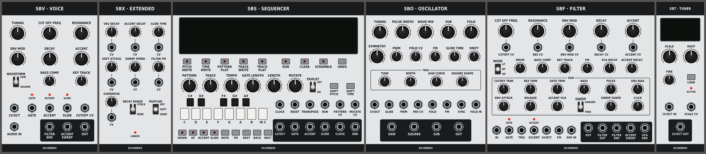

# Silverbox for VCV Rack

Silverbox is a model of the 1981 TB-303 bass line synthesizer, in six modules. The first three are the 303 itself; the other three (added in 2.1.0) open it up. The modules can be used together or with anything else in your rack.

| Module | What it is |
|---|---|
| **SBV Silverbox Voice** (16 HP) | The 303 voice: oscillator, diode ladder filter, envelopes, accent, slide. It has two additions, BASS COMP and KEY TRACK |
| **SBS Silverbox Sequencer** (32 HP) | The 303 sequencer, with separate pitch and time programming, 64 patterns, 7 tracks and tools for generating material |
| **SBX Silverbox Extended** (12 HP) | An expander that sits directly to the right of SBV and adds extended controls, each with a CV input |
| **SBO Silverbox Oscillator** (20 HP) | The 303 oscillator on its own, with pulse width, PWM, a sub-octave, a wavefolder, sync, FM and its board trimmers |
| **SBF Silverbox Filter** (28 HP) | The rest of the voice: diode ladder (low-pass, band-pass or high-pass), both envelopes, accent and VCA, with the board's fixed values as knobs |
| **SBT Silverbox Tuner** (8 HP) | Scala microtuning for any 1V/OCT signal, eight scale slots, polyphonic |

With its knobs at default and no SBX attached, SBV behaves like a stock 303. Every addition leaves the stock sound alone until you use it. SBO into SBF with everything at default sounds exactly like SBV.

---

## SBV Silverbox Voice

### Controls

| Control | What it does |
|---|---|
| TUNING | ±12 semitones, continuous |
| CUT OFF FREQ | Where the filter's resonant peak sits, 125 Hz to 2 kHz, with 500 Hz at half way (the service-note calibration) |
| RESONANCE | Filter feedback. Also sets how the accent sweep behaves (see below) |
| ENV MOD | How far the filter envelope opens the filter. Turning it up also lowers the resting cutoff, as on the original |
| DECAY | Filter envelope decay, 0.2 s to 2 s. Accented notes always use the shortest decay |
| ACCENT | How much an accent opens the filter and raises the volume |
| WAVEFORM | SAW or SQUARE. The square is shaped from the saw, so it is darker than a textbook square and slightly off-centre |
| BASS COMP | Puts back the low end that drops away as RESONANCE goes up, without changing the resonant peak. 0 = stock |
| KEY TRACK | Makes the cutoff follow pitch, 0 to 100%. It pivots around C3 (1 V) and follows slides. 0 = stock |

| Jack | |
|---|---|
| 1V/OCT | Pitch. 0 V = C2 |
| GATE | A rising edge starts both envelopes. While GATE stays high nothing retriggers |
| ACCENT | High = accented note |
| SLIDE | If SLIDE is high when the pitch changes, the pitch glides into the new note (about 60 ms) instead of jumping |
| CUTOFF CV | ±5 V moves the cutoff ±3 octaves |
| AUDIO IN | Replaces the oscillator, so anything can go through the 303 filter, envelopes and accent |
| FILTER ENV | The filter envelope, 0 to 10 V |
| ACCENT SWEEP | The accent sweep, 0 to 10 V |
| OUT | Audio, about ±5 V on normal notes |

The GATE, ACCENT and SLIDE lights show those inputs.

> **Changed in 2.1.0.** CUT OFF FREQ now follows the 303 service notes: half way puts the resonant peak at about 500 Hz. Before 2.1.0 the range was 300 Hz to 5 kHz, which was too bright. **Patches saved before 2.1.0 will sound darker; turn CUT OFF FREQ up by about a third of its travel to get the old sound.** Nothing else about SBV changed.

### How the voice behaves

- **Notes are as long as the gate.** The amplitude envelope decays slowly (about 3.5 s) while the gate is held, then closes in a few milliseconds when the gate drops.
- **Accent does three things at once.** It forces the shortest filter decay, raises the volume, and charges the *accent sweep*, which adds to the cutoff.
- **The accent sweep depends on RESONANCE.** At low resonance each accent is a sharp spike. At high resonance it becomes a rounded swell that peaks around 60 ms in. It also discharges slowly, so a run of accents climbs higher each time. Most clones leave this out. In practice:
  - resonance low: accents bark;
  - resonance high: four accents in a row scream upwards.
- **Slide** glides in a fixed time, whatever the interval. An octave and a semitone take the same 60 ms.

### Driving SBV from another sequencer

Any gate sequencer works:

1. Patch pitch to 1V/OCT and gate to GATE.
2. For an accent, send a gate to ACCENT that is high when the note's gate rises.
3. For a slide, keep GATE high across both notes, and have SLIDE high at the moment the pitch changes. A simple way is to send the same gate to SLIDE on the step that slides into the next one, and lengthen GATE on that step to 100%.

---

## SBS Silverbox Sequencer

### How the 303 is programmed

The original 303 stores **pitch** and **time** as two separate lists:

- The **pitch list** holds up to 16 notes. Each note has its own UP or DOWN (octave), ACCENT and SLIDE.
- The **time list** says, for each step, **NOTE**, **TIE** or **REST**.
- When the pattern plays, each NOTE step takes the **next** note from the pitch list. A TIE holds the previous note, and a REST is silence.

So the lists are not lined up step for step. Turn one REST into a NOTE and every later note, accent and slide moves one step along. People found lines this way that they would never have written on purpose. SBS keeps this behaviour, and the display shows what is happening.

### The display

- **PITCH**: the 16 pitch slots: note name, ▲ or ▼ for octave, and A and S for accent and slide.
- **TIME**: a dot for NOTE, a dash for TIE, blank for REST. Steps past LENGTH are dimmed.
- **RESULT**: what actually plays. A thin line runs from each RESULT note up to the pitch slot it uses.
- **Header line**: the mode, the pattern being edited, the pattern playing (if it is a different one), the next pattern if one is queued, the track position, the tempo or EXT, TRIP, and the live transpose.

**Click** a PITCH or TIME cell to move the edit cursor there.

**Click a RESULT cell** to edit that step directly: its note, octave, accent, slide, and time. Note, octave, accent and slide change the pitch slot that step uses. Time changes the time list, so it may shift later notes, and the menu says so.

### Modes (the five lit buttons)

| Mode | Keys | Other buttons |
|---|---|---|
| PITCH WRITE | Set the note of the current pitch slot. If stopped, you hear it | DOWN / UP / ACCENT / SLIDE toggle that slot's flags. NEXT / BACK move along |
| TIME WRITE | — | NOTE / TIE / REST write a step and move on. NEXT / BACK move without writing |
| PATTERN PLAY | Live transpose: C = 0 up to HI C = +12. Hold DOWN for −12 to 0 | |
| TRACK WRITE | Set the transpose of the slot being entered | PATTERN picks the slot's pattern. NEXT stores the slot and moves on. Holding CLEAR cuts the track at the cursor |
| TRACK PLAY | Live transpose, as in Pattern play | Plays the selected track's slots in order, then loops |

Changing mode never stops playback, so you can edit while it runs.

### Other controls

| Control | What it does |
|---|---|
| RUN | Start and stop |
| CLEAR (hold 1 s) | Clears the pattern. In Track write it cuts the track at the cursor |
| SCRAMBLE (hold 1 s) | Randomises the pattern, like a 303 whose batteries were pulled |
| UNDO | Undoes the last memory change, 32 levels |
| PATTERN | Selects one of 64 patterns (I-1A to IV-8B). While running, the change waits for the end of the loop |
| TRACK | Selects one of 7 tracks |
| TEMPO | 40 to 300 BPM. It is ignored when CLOCK is patched |
| GATE LENGTH | 10% to 95% of a step, with a detent at the original 50% |
| LENGTH | 1 to 16 steps. It is stored with the pattern |
| MUTATE | At the end of every loop, makes up to 4 random changes to the pattern, written to memory |
| TRIPLET | Triplet steps (12 steps to a bar of 4/4 at 16ths). It is stored with the pattern |
| SHIFT PITCH / SHIFT TIME | Rotate one list by one slot against the other: the classic way to get a variation |

| Jack | |
|---|---|
| CLOCK | External clock. The context menu sets 24 PPQN (the default, as the original's sync), 1 per step, or 4 PPQN |
| RESET | Back to step 1 |
| TRANSPOSE | 1V/oct, in semitones |
| RUN | A trigger toggles run. The context menu can make it a gate instead |
| PATTERN CV | 0 to 10 V adds 0 to 63 to PATTERN |
| MUTATE CV | ±5 V adds to MUTATE |
| 1V/OCT, GATE, ACCENT, SLIDE | Patch these to the same jacks on SBV |
| CLOCK | One trigger per step |
| END | A trigger at the start of each pattern loop |

The **context menu** also has Copy pattern, Paste pattern, Copy to next empty pattern, Clear all memory, and Export or Import memory as a JSON file. All 64 patterns and 7 tracks are saved with your patch.

### Tuning (Scala microtuning, new in 2.1.0)

The context menu's **Tuning** submenu retunes SBS's 1V/OCT output:

- **Load Scala scale (.scl)…** and **Load keyboard mapping (.kbm)…** read the standard Scala files. A file that cannot be read shows FILE ERROR on the display and changes nothing.
- **Built-in scales**: 12-tone equal, Just intonation, Pythagorean, Quarter-comma meantone, Werckmeister III, Harmonic series 8 to 16, 7-, 19- and 24-tone equal, Bohlen-Pierce, Wendy Carlos alpha, Slendro and Pelog.
- **Key mapping**: *12 keys per period* (each octave of keys covers one period of the scale; scales with fewer than 12 notes share keys) or *One key per degree* (every key is the next scale step).
- **Root**: which key plays the scale's 1/1.
- **Reset to 12-tone equal**.

The keys become scale degrees, UP and DOWN move by one period, and the key and track transposes move by degrees. The **TRANSPOSE jack stays an exact pitch shift**, added after the scale. The scale is saved with the patch (not the file name), and its name appears in the display header after the tempo. With 12-tone equal, SBS behaves exactly as before.

---

## SBX Silverbox Extended

Place SBX directly to the right of SBV, and its LINKED light comes on. At its default positions it changes nothing. Each knob has a CV input below it: ±5 V sweeps the whole range.

| Control | Range (default) | What it does |
|---|---|---|
| VEG DECAY | 16 ms to 6 s (3.5 s) | How long a held note takes to fade |
| ACCENT DECAY | 30 ms to 3 s (0.2 s) | Filter decay on accented notes |
| SLIDE TIME | 2 ms to 500 ms (60 ms) | Glide time |
| SOFT ATTACK | 0.3 ms to 30 ms (3 ms) | Volume attack on non-accented notes |
| SWEEP SPEED | ×0.25 to ×4 (×1) | Speed of the accent sweep |
| FILTER FM | 0 to 100% (0) | Feeds the voice's own output into the cutoff at audio rate: grit and growl |
| OVERDRIVE | 0 to 24 dB (0) | Drives the filter input harder |
| DECAY RANGE | STOCK / WIDE | WIDE makes SBV's DECAY run from 30 ms to 3 s |
| MUFFLER | OFF / SOFT / HARD | A soft clipper on the output |

---

## SBO Silverbox Oscillator

The 303 oscillator with the lid off. With every control at its default, SAW and SQUARE are exactly SBV's waveforms. Patch the sequencer's 1V/OCT and SLIDE here, and OUT into SBF IN.

| Control | Range (default) | What it does |
|---|---|---|
| TUNING | ±12 semitones (0) | |
| PULSE WIDTH | 5% to 95% (46.5%, stock) | Width of the square. It has a small detent at the stock value. The square is still shaped from the saw, so it keeps its slanted 303 edges at every width |
| WAVE MIX | saw to square (saw) | Crossfade between the two |
| SUB | 0 to 100% (0) | How much of the sub-octave square goes into OUT |
| FOLD | 0 to 100% (0) | Wavefolder after the mix. At 0 the signal passes untouched |
| SYMMETRY | −100% to +100% (0) | Bias into the folder: folds one side more than the other and adds even harmonics. Does nothing while FOLD is 0 |
| PWM | −100% to +100% (0) | Depth of the PWM input: ±5 V at full depth moves the width ±45% |
| FOLD CV | −100% to +100% (0) | Depth of the FOLD input: ±5 V at full depth sweeps the whole range |
| FM | 0 to 100% (0) | Linear FM depth: ±5 V at full depth swings the frequency between 0 and twice the pitch |
| SLIDE TIME | 2 ms to 500 ms (60 ms) | As SBX |
| DRIFT | 0 to 100% (0) | A slow random wander of up to about ±24 cents |

**TRIM** (the board trimmers and two fixed values):

| Control | Range (default) | What it does |
|---|---|---|
| TUNE | ±100 cents (0) | Board trimmer TM4 |
| WIDTH | 0.90 to 1.10 (1.00) | Board trimmer TM5: the volts-per-octave scale, pivoting at 0 V. 1.05 stretches every octave by 5% |
| SAW CURVE | 0 to 3 (0.6, stock) | Curvature of the capacitor-charge saw. 0 is a straight ramp |
| SQUARE SHAPE | 1.5 to 20 (6, stock) | Gain of the transistor that makes the square: low values give a rounded, soft square, high values a hard one |

| Jack | |
|---|---|
| 1V/OCT, SLIDE | As SBV: SLIDE high at a pitch change glides instead of jumping |
| PWM, MIX CV, FOLD, FM | CV for those controls. MIX CV: ±5 V = ±1 |
| SYNC | Hard sync: the cycle restarts when this input rises through 0 V |
| FOLD IN | Replaces the oscillator mix going into the folder, so the folder works on anything |
| SAW, SQUARE, SUB | The raw waveforms, about ±5 V |
| OUT | Saw/square mix plus sub, through the folder, at the level SBF expects (into SBF it matches SBV) |

---

## SBF Silverbox Filter

The back half of the voice: input → diode ladder → VCA, with the filter envelope, the volume envelope and the accent circuit. Patch GATE and ACCENT here. With everything at default and SBO's OUT in IN, it sounds exactly like SBV.

| Control | Range (default) | What it does |
|---|---|---|
| CUT OFF FREQ, RESONANCE, ENV MOD, DECAY, ACCENT | as SBV | Each has a CV jack under it. CUTOFF CV: ±5 V = ±3 octaves. The others: ±5 V adds ±100% |
| MODE | LP / BP / HP (LP) | Which output of the ladder you hear. The resonance, accent and saturation are the same in every mode; only the tap changes, crossfaded over 5 ms |
| DRIVE | 0 to 24 dB (0) | Level into the ladder |
| BASS COMP | 0 to 100% (0) | As SBV, low-pass only |
| KEY TRACK | 0 to 100% (0) | Cutoff follows the 1V/OCT input, pivoting at 1 V |
| FM | 0 to 100% (0) | Depth of the FM input: ±5 V at full depth = ±2 octaves, at audio rate |
| VCA DECAY | 16 ms to 6 s (3.5 s, stock) | How long a held note takes to fade |
| ACCENT DECAY | 30 ms to 3 s (0.2 s, stock) | Filter decay on accented notes |

**TRIM** (board trimmers, and fixed parts made variable):

| Control | Range (default) | What it does |
|---|---|---|
| CUTOFF TRIM | ±2 octaves (0) | Board trimmer TM3. +1.3 octaves gives the brighter range SBV had before 2.1.0 |
| RES TRIM | 0.5 to 1.1 (1.0) | Scales the feedback at full RESONANCE. Above about 1.005 the filter self-oscillates |
| GATE TRIM | 20 ms to 2 s, OFF (OFF) | Shortens notes: the VCA closes when the gate falls or when this time has passed, whichever is first. Fully clockwise is OFF |
| BASS | 20 Hz to 400 Hz (150 Hz) | Corner of the high-pass in the resonance feedback. Lower keeps resonance strong at low cutoffs |
| POLES | 1.0 to 3.0 (1.8) | Ratio of the bottom ladder capacitor. Its effect is subtle: below 1.8 the passband just under the cutoff gets slightly thinner |
| ENV BIAS | 0 to 2 octaves (1.2) | How far full ENV MOD lowers the resting cutoff |
| ENV ATTACK | 3 ms to 300 ms (3 ms) | Filter envelope attack. Longer gives swelling "wow" sweeps |
| RELEASE | 4 ms to 1 s (4 ms) | How fast the VCA closes after the gate. Longer lets notes ring and overlap |
| ACCENT VCA | 0 to 2 (1) | How much an accent raises the volume, separately from how much it opens the filter |
| SWEEP | GANGED / FREE (GANGED) | GANGED: the accent sweep's shape follows RESONANCE, as on the board. FREE: it follows SWEEP SHAPE instead |
| SWEEP SHAPE | 0 to 100% (50%) | The accent sweep's shape when SWEEP is FREE: low is sharp, high is a slow swell |
| CLICK | 0 to 100% (0) | Adds the thump of an untrimmed VCA at each note start (up to about 0.45 V) |

| Jack | |
|---|---|
| IN | Audio, ±5 V nominal |
| GATE | As SBV |
| TRIG | A rising edge restarts both envelopes, even while GATE is high. With GATE unpatched, TRIG alone plays notes (each lasts GATE TRIM, or 125 ms when it is OFF) |
| ACCENT | **A level**: 1 V and above is an accent, and its strength is the voltage over 5 V (at least 20%). 5 V or 10 V gates give full accents, so any gate sequencer behaves as with SBV, and a velocity CV gives half accents |
| 1V/OCT | For KEY TRACK only |
| FM | Audio-rate cutoff modulation |
| ENV IN | 0 to 10 V replaces the filter envelope while patched |
| OUT | Audio, after the VCA |
| FILTER OUT | The filter before the VCA, at the same level as OUT on a held note |
| FILTER ENV, ACCENT SWEEP, VCA ENV | The envelopes, 0 to 10 V |

**Notes.** A slide holds the gate across notes, so a short GATE TRIM cuts the second note of a slide; that is expected. With RES TRIM up and nothing in IN, the filter is a sine oscillator of about 1.4 V: open the VCA with a held gate (or use FILTER OUT) and play it with KEY TRACK at 100%.

---

## SBT Silverbox Tuner

A 1V/OCT retuner that loads Scala files. Put it between any sequencer's 1V/OCT and any oscillator.

| Control | What it does |
|---|---|
| Display | Slot number, scale name, number of notes and the mapping mode |
| SCALE | Slot 1 to 8. SCALE CV adds (0 to 10 V = 0 to 7 slots, wrapping) |
| ROOT | Which key plays the scale's 1/1 (C to B) |
| FINE | ±100 cents on everything |
| LOAD | Opens a .scl file into the current slot |
| ACTIVE | Lit when the current slot is not 12-tone equal |
| 1V/OCT IN / OUT | Polyphonic, up to 16 channels, each mapped separately |

The context menu works on the current slot: load a .scl or .kbm, clear the mapping, built-in scales, key mapping (*12 keys per period* or *One key per degree*), reset the slot, reset all slots. Default slots: 1 12-tone equal, 2 Just, 3 Pythagorean, 4 Meantone, 5 7-equal, 6 19-equal, 7 Bohlen-Pierce, 8 Harmonic 8 to 16. All eight scales are saved in the patch.

Whole semitones land exactly on scale pitches. Anything in between (a slide or a bend) is interpolated between neighbouring scale pitches, so slides pass through smoothly. A .kbm file replaces the key mapping: it maps keys relative to its middle note (MIDI 60 = 0 V), keys it leaves unmapped hold the previous pitch, and its reference note and frequency set the absolute pitch.

**SBS's Tuning menu or SBT?** Both use the same scales and mapping. Use SBS's own menu for a single 303 line; it keeps the TRANSPOSE jack an exact shift. Use SBT for other sequencers, to switch scales by CV, and for polyphony. Through SBT, SBS's TRANSPOSE jack moves by scale degrees. Do not use both at once.

---

## Patch recipes

Each recipe is a list of cables. The distortion in these recipes is **NYSTHI RodentV2**, a free model of the ProCo RAT, the pedal most often used on a 303. The delay is VCV's free **Delay**. Any distortion and delay will do.

### 1. First acid line
- SBS 1V/OCT → SBV 1V/OCT, SBS GATE → SBV GATE, SBS ACCENT → SBV ACCENT, SBS SLIDE → SBV SLIDE.
- SBV OUT → RodentV2 in → Delay in → Audio.
- SBV: CUT OFF FREQ 30%, RESONANCE 75%, ENV MOD 60%, DECAY 30%, ACCENT 80%, SAW.
- SBS: press RUN. Pattern I-1A holds a demo line. Then sweep CUT OFF FREQ and RESONANCE slowly by hand: that is the whole genre.

### 2. Programming the 303 way
1. Choose an empty pattern (for example I-2A) and press **PITCH WRITE**.
2. Enter C, C, D#, C, G, A#, with NEXT between notes. Press UP on the second C and ACCENT on the G.
3. Press **TIME WRITE** and enter NOTE, REST, NOTE, NOTE, TIE, NOTE.
4. Press RUN and watch the RESULT row.
5. Click the second TIME cell and press NOTE. Every later note moves one step along and the accent lands somewhere new. Press UNDO to go back.

### 3. Generate, save, perform
1. Hold **SCRAMBLE** for one second. Listen. Repeat until something catches.
2. Set **MUTATE** to about 10% and let it run. Each loop drifts a little.
3. When it is good, set MUTATE to 0 and choose **Copy to next empty pattern** from the context menu. Carry on from there.
4. Press **TRACK WRITE**. For each slot, turn PATTERN to a kept pattern, press a key for transpose, and press NEXT.
5. Press **TRACK PLAY** to perform. Use the keys for live transpose, and PATTERN CV or MUTATE CV from an LFO for slow change.

### 4. The accent stack
Program four accented notes in a row (ACCENT on four pitch slots, four NOTE steps).
- With RESONANCE at 10%, each accent is the same short bark.
- With RESONANCE at 90%, each accent climbs above the last. Watch the ACCENT SWEEP output on a scope to see it charge.

### 5. SBV from another sequencer
Use VCV SEQ-3 (or any gate sequencer):
- Its pitch row → SBV 1V/OCT, its trigger or gate → SBV GATE.
- A second gate row → SBV ACCENT.
- For slides, send a third gate row to SLIDE, and set that sequencer's gate length to 100% on the slid steps.

### 6. Drums through the 303 filter
- A drum loop or a drum machine output → SBV AUDIO IN.
- The kick triggers → SBV GATE, the snare triggers → SBV ACCENT.
- RESONANCE 60%, ENV MOD 70%, DECAY 20%. The kick pumps the filter, and each snare gets an accent sweep.

### 7. SBX squelch
- SBX next to SBV. FILTER FM 25%, OVERDRIVE 9 dB, MUFFLER SOFT.
- Raise RESONANCE until it growls. FILTER FM makes the resonance bite on every note.

### 7a. BASS COMP and KEY TRACK
- Turn RESONANCE to 90% and notice how the bass thins. Then raise **BASS COMP** to bring the weight back under the scream.
- For lines that jump octaves, set **KEY TRACK** to 50 to 100% so high and low notes stay equally bright.

### 8. Unstable time
- Use a clock whose rate is wobbled by a slow random voltage. Patch it into SBS CLOCK, and set the context menu to **1 per step**.
- Set GATE LENGTH to 95% so the slides stay connected, and MUTATE to 5%.
- This works well alongside the Autechre-style set in this project.

### 9. The open voice
- SBS 1V/OCT → SBO 1V/OCT, SBS SLIDE → SBO SLIDE, SBO OUT → SBF IN, SBS GATE → SBF GATE, SBS ACCENT → SBF ACCENT, SBF OUT → Audio.
- Everything at default: this is SBV. Now try the trimmers one at a time:
  - **CUTOFF TRIM** moves the whole cutoff range; **ENV BIAS** sets how dark the resting filter gets as ENV MOD rises.
  - **BASS** down to 40 Hz keeps the resonance strong on low cutoffs; **RES TRIM** above 1.0 makes the resonance ring on and sing.
  - **ENV ATTACK** at 100 ms turns each note into a swell; **RELEASE** at 300 ms lets notes ring into each other.
  - **GATE TRIM** at 60 ms makes everything staccato; **CLICK** gives the notes a thump.
  - **TUNE**, **WIDTH**, **SAW CURVE** and **SQUARE SHAPE** on SBO change the raw tone: a straighter saw is brighter, a soft square is hollow.

### 10. PWM acid
- As recipe 9. SBO WAVE MIX at square. A slow LFO (0.3 Hz, ±5 V) → SBO PWM, PWM knob at 50%.
- SBF RESONANCE 85%. The width sweep moves the harmonics under the resonance, so the filter sings different partials as it opens.

### 11. Folded acid
- As recipe 9. SBF FILTER ENV → SBO FOLD, FOLD CV at 40%, FOLD at 10%, SYMMETRY at +30%.
- Each note's filter envelope also folds the wave, so accents (which push the envelope) fold hardest. SYMMETRY off-centre adds a hollow, octave-up edge.

### 12. Band-pass and high-pass lines
- As recipe 9, SBF MODE BP: a nasal, vocal line. HP: a thin, buzzing top line.
- **Two layers**: run SBS into SBV (low-pass bass) and also into SBO + SBF (MODE HP, CUTOFF TRIM +1 octave). Mix both. The bass stays round while the top layer bites.

### 13. Self-oscillating filter as a voice
- Nothing in SBF IN. RES TRIM fully up, RESONANCE 100%, ENV MOD 0, KEY TRACK 100%.
- SBS 1V/OCT → SBF 1V/OCT (KEY TRACK at 100% follows it at one octave per volt); SBS GATE → SBF GATE. CUTOFF CV is free for vibrato from an LFO.
- Use FILTER OUT for a constant sine, or OUT for the 303's envelope shape. Tune it with CUT OFF FREQ and CUTOFF TRIM.

### 14. Half accents
- A random or velocity CV (0 to 5 V) → SBF ACCENT, instead of a gate. Low voltages give gentle accents, 5 V and above full ones.
- A sample-and-hold of noise, clocked by SBS CLOCK, gives a line where every note is accented a little differently.

### 15. Sub and BASS
Three ways to keep the low end under heavy resonance:
- **SUB** (SBO) adds a square an octave down: more weight, below the filter's action.
- **BASS** (SBF) lowers the feedback high-pass: the resonance stays strong on low notes, but the bass under it still thins.
- **BASS COMP** (SBF, low-pass) adds the lost low end back: the most like an un-resonant filter underneath.
Try all three on a line with RESONANCE at 90%.

### 16. Wrong tracking
- SBO WIDTH at 1.04: every octave is 4% wide, so a line stretches as it climbs. Pleasantly wrong on octave jumps.
- The principled version: SBS → SBT (a stretched or non-octave scale such as Wendy Carlos alpha) → SBO.

### 17. Microtonal acid
- SBS 1V/OCT → SBT 1V/OCT IN → SBV 1V/OCT. SBT SCALE at slot 2 (Just): thirds and sevenths settle into pure intervals.
- Slot 7 (Bohlen-Pierce, one key per degree): each key is the next step of a 13-step scale that repeats at the twelfth, not the octave.
- Switching per pattern: a stepped CV from another sequencer, clocked by SBS END, into SBT SCALE CV changes scale at each loop.

### 18. SBF as a processor
- A drum loop or another oscillator → SBF IN. A clock divider's output → SBF TRIG, GATE unpatched, GATE TRIM at 150 ms.
- Each trigger plays a 303 note shape on the input: filter sweep, VCA and (with a gate into ACCENT) accent.

---

## What is modelled

- **Oscillator:** a falling saw with the slight curve of a charging capacitor. The square is made from the saw by a transistor-style shaper (about 46% duty, slanted edges, slight droop). The audio path is oversampled.
- **Filter:** a four-stage coupled diode ladder with a smaller bottom capacitor. It rolls off at about 16 dB/oct in the first octaves rather than 24. A 150 Hz high-pass in the feedback path thins resonance at low cutoffs, and soft saturation at the input adds grit. Full resonance rings but does not quite self-oscillate.
- **Envelopes:** a filter envelope with a 3 ms attack and 0.2 to 2 s decay, forced short on accents. A volume envelope with a long fixed decay and a fast close on gate off.
- **Accent:** a sweep capacitor driven by the filter envelope on accented notes. RESONANCE sets how fast it charges and discharges, as the original's dual-gang resonance pot did. Accents also raise the volume.
- **Slide:** a fixed-time glide with no envelope retrigger.
- **Sequencer:** separate pitch and time lists, ties, rests, 24 PPQN timing, 50% gates, triplets, 64 patterns in four groups of 8 × A/B, and 7 tracks.

- **Round 2 (SBO, SBF, SBT):** the cutoff calibration (500 Hz ± 100 Hz at half way) and the trimmers TM3 (cutoff), TM4 (tune) and TM5 (width) come from the service notes. The other TRIM controls (GATE TRIM, RES TRIM, BASS, POLES, ENV BIAS, ENV ATTACK, RELEASE, ACCENT VCA, SWEEP, SQUARE SHAPE, SAW CURVE) are **not original trimmers**: they are fixed parts or ganged pots of the circuit made variable for this plugin. The folder, drift, sub level, accent level law and band-pass/high-pass levels are this build's own design.

Every constant is an estimate made from published descriptions rather than a measurement of a real unit. They are listed in `src/dsp/Constants303.hpp`, and `docs/DECISIONS.md` explains each one that was changed.

*"Roland" and "TB-303" are trademarks of their owner. Silverbox is an independent model.*
